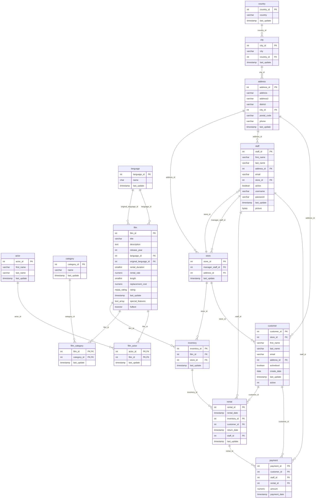

# Sakila Schema

PostgreSQL 15 Sakila database as loaded by `init-sakila.sh`: 15 base tables, their columns and keys, and the first 5 rows of each (ordered by primary key).

Views and the monthly `payment_p2007_*` child tables (same columns as `payment`) are not shown.

## Entity relationship diagram

## Tables

| Table | Group | Rows | Columns |
| --- | --- | ---: | ---: |
| [`rental`](#rental) | Transactions | 16,044 | 7 |
| [`payment`](#payment) | Transactions | 16,049 | 6 |
| [`inventory`](#inventory) | Transactions | 4,581 | 4 |
| [`film`](#film) | Film catalog | 1,000 | 14 |
| [`film_actor`](#film_actor) | Film catalog | 5,462 | 3 |
| [`actor`](#actor) | Film catalog | 200 | 4 |
| [`film_category`](#film_category) | Film catalog | 1,000 | 3 |
| [`category`](#category) | Film catalog | 16 | 3 |
| [`language`](#language) | Film catalog | 6 | 3 |
| [`customer`](#customer) | People & stores | 599 | 10 |
| [`staff`](#staff) | People & stores | 2 | 11 |
| [`store`](#store) | People & stores | 2 | 4 |
| [`address`](#address) | Location | 603 | 8 |
| [`city`](#city) | Location | 600 | 4 |
| [`country`](#country) | Location | 109 | 3 |

## Transactions

### rental

16,044 rows

| Column | Type | Key | Null |
| --- | --- | --- | --- |
| `rental_id` | integer | PK | NOT NULL |
| `rental_date` | timestamp without time zone |  | NOT NULL |
| `inventory_id` | integer | FK → `inventory` | NOT NULL |
| `customer_id` | integer | FK → `customer` | NOT NULL |
| `return_date` | timestamp without time zone |  |  |
| `staff_id` | integer | FK → `staff` | NOT NULL |
| `last_update` | timestamp without time zone |  | NOT NULL |

**First 5 rows**

| rental_id | rental_date | inventory_id | customer_id | return_date | staff_id | last_update |
| --- | --- | --- | --- | --- | --- | --- |
| 1 | 2005-05-24 22:53:30 | 367 | 130 | 2005-05-26 22:04:30 | 1 | 2006-02-15 21:30:53 |
| 2 | 2005-05-24 22:54:33 | 1525 | 459 | 2005-05-28 19:40:33 | 1 | 2006-02-15 21:30:53 |
| 3 | 2005-05-24 23:03:39 | 1711 | 408 | 2005-06-01 22:12:39 | 1 | 2006-02-15 21:30:53 |
| 4 | 2005-05-24 23:04:41 | 2452 | 333 | 2005-06-03 01:43:41 | 2 | 2006-02-15 21:30:53 |
| 5 | 2005-05-24 23:05:21 | 2079 | 222 | 2005-06-02 04:33:21 | 1 | 2006-02-15 21:30:53 |

### payment

16,049 rows

| Column | Type | Key | Null |
| --- | --- | --- | --- |
| `payment_id` | integer | PK | NOT NULL |
| `customer_id` | integer | FK → `customer` | NOT NULL |
| `staff_id` | integer | FK → `staff` | NOT NULL |
| `rental_id` | integer | FK → `rental` | NOT NULL |
| `amount` | numeric |  | NOT NULL |
| `payment_date` | timestamp without time zone |  | NOT NULL |

**First 5 rows**

| payment_id | customer_id | staff_id | rental_id | amount | payment_date |
| --- | --- | --- | --- | --- | --- |
| 1 | 1 | 1 | 76 | 2.99 | 2005-05-25 11:30:37 |
| 2 | 1 | 1 | 573 | 0.99 | 2005-05-28 10:35:23 |
| 3 | 1 | 1 | 1185 | 5.99 | 2005-06-15 00:54:12 |
| 4 | 1 | 2 | 1422 | 0.99 | 2005-06-15 18:02:53 |
| 5 | 1 | 2 | 1476 | 9.99 | 2005-06-15 21:08:46 |

### inventory

4,581 rows

| Column | Type | Key | Null |
| --- | --- | --- | --- |
| `inventory_id` | integer | PK | NOT NULL |
| `film_id` | integer | FK → `film` | NOT NULL |
| `store_id` | integer | FK → `store` | NOT NULL |
| `last_update` | timestamp without time zone |  | NOT NULL |

**First 5 rows**

| inventory_id | film_id | store_id | last_update |
| --- | --- | --- | --- |
| 1 | 1 | 1 | 2006-02-15 05:09:17 |
| 2 | 1 | 1 | 2006-02-15 05:09:17 |
| 3 | 1 | 1 | 2006-02-15 05:09:17 |
| 4 | 1 | 1 | 2006-02-15 05:09:17 |
| 5 | 1 | 2 | 2006-02-15 05:09:17 |

## Film catalog

### film

1,000 rows

| Column | Type | Key | Null |
| --- | --- | --- | --- |
| `film_id` | integer | PK | NOT NULL |
| `title` | character varying(255) |  | NOT NULL |
| `description` | text |  |  |
| `release_year` | integer |  |  |
| `language_id` | integer | FK → `language` | NOT NULL |
| `original_language_id` | integer | FK → `language` |  |
| `rental_duration` | smallint |  | NOT NULL |
| `rental_rate` | numeric |  | NOT NULL |
| `length` | smallint |  |  |
| `replacement_cost` | numeric |  | NOT NULL |
| `rating` | mpaa_rating |  |  |
| `last_update` | timestamp without time zone |  | NOT NULL |
| `special_features` | ARRAY |  |  |
| `fulltext` | tsvector |  | NOT NULL |

**First 5 rows**

| film_id | title | description | release_year | language_id | original_language_id | rental_duration | rental_rate | length | replacement_cost | rating | last_update | special_features | fulltext |
| --- | --- | --- | --- | --- | --- | --- | --- | --- | --- | --- | --- | --- | --- |
| 1 | ACADEMY DINOSAUR | A Epic Drama of a Feminist And a Mad Scientist who must B… | 2006 | 1 | _null_ | 6 | 0.99 | 86 | 20.99 | PG | 2006-02-15 05:03:42 | Deleted Scenes, Behind the Scenes | 'academi':1 'battl':15 'canadian':20 'dinosaur':2 'drama'… |
| 2 | ACE GOLDFINGER | A Astounding Epistle of a Database Administrator And a Ex… | 2006 | 1 | _null_ | 3 | 4.99 | 48 | 12.99 | G | 2006-02-15 05:03:42 | Trailers, Deleted Scenes | 'ace':1 'administr':9 'ancient':19 'astound':4 'car':17 '… |
| 3 | ADAPTATION HOLES | A Astounding Reflection of a Lumberjack And a Car who mus… | 2006 | 1 | _null_ | 7 | 2.99 | 50 | 18.99 | NC-17 | 2006-02-15 05:03:42 | Trailers, Deleted Scenes | 'adapt':1 'astound':4 'baloon':19 'car':11 'factori':20 '… |
| 4 | AFFAIR PREJUDICE | A Fanciful Documentary of a Frisbee And a Lumberjack who … | 2006 | 1 | _null_ | 5 | 2.99 | 117 | 26.99 | G | 2006-02-15 05:03:42 | Commentaries, Behind the Scenes | 'affair':1 'chase':14 'documentari':5 'fanci':4 'frisbe':… |
| 5 | AFRICAN EGG | A Fast-Paced Documentary of a Pastry Chef And a Dentist w… | 2006 | 1 | _null_ | 6 | 2.99 | 130 | 22.99 | G | 2006-02-15 05:03:42 | Deleted Scenes | 'african':1 'chef':11 'dentist':14 'documentari':7 'egg':… |

### film_actor

5,462 rows

| Column | Type | Key | Null |
| --- | --- | --- | --- |
| `actor_id` | integer | PK, FK → `actor` | NOT NULL |
| `film_id` | integer | PK, FK → `film` | NOT NULL |
| `last_update` | timestamp without time zone |  | NOT NULL |

**First 5 rows**

| actor_id | film_id | last_update |
| --- | --- | --- |
| 1 | 1 | 2006-02-15 05:05:03 |
| 1 | 23 | 2006-02-15 05:05:03 |
| 1 | 25 | 2006-02-15 05:05:03 |
| 1 | 106 | 2006-02-15 05:05:03 |
| 1 | 140 | 2006-02-15 05:05:03 |

### actor

200 rows

| Column | Type | Key | Null |
| --- | --- | --- | --- |
| `actor_id` | integer | PK | NOT NULL |
| `first_name` | character varying(45) |  | NOT NULL |
| `last_name` | character varying(45) |  | NOT NULL |
| `last_update` | timestamp without time zone |  | NOT NULL |

**First 5 rows**

| actor_id | first_name | last_name | last_update |
| --- | --- | --- | --- |
| 1 | PENELOPE | GUINESS | 2006-02-15 04:34:33 |
| 2 | NICK | WAHLBERG | 2006-02-15 04:34:33 |
| 3 | ED | CHASE | 2006-02-15 04:34:33 |
| 4 | JENNIFER | DAVIS | 2006-02-15 04:34:33 |
| 5 | JOHNNY | LOLLOBRIGIDA | 2006-02-15 04:34:33 |

### film_category

1,000 rows

| Column | Type | Key | Null |
| --- | --- | --- | --- |
| `film_id` | integer | PK, FK → `film` | NOT NULL |
| `category_id` | integer | PK, FK → `category` | NOT NULL |
| `last_update` | timestamp without time zone |  | NOT NULL |

**First 5 rows**

| film_id | category_id | last_update |
| --- | --- | --- |
| 1 | 6 | 2006-02-15 05:07:09 |
| 2 | 11 | 2006-02-15 05:07:09 |
| 3 | 6 | 2006-02-15 05:07:09 |
| 4 | 11 | 2006-02-15 05:07:09 |
| 5 | 8 | 2006-02-15 05:07:09 |

### category

16 rows

| Column | Type | Key | Null |
| --- | --- | --- | --- |
| `category_id` | integer | PK | NOT NULL |
| `name` | character varying(25) |  | NOT NULL |
| `last_update` | timestamp without time zone |  | NOT NULL |

**First 5 rows**

| category_id | name | last_update |
| --- | --- | --- |
| 1 | Action | 2006-02-15 04:46:27 |
| 2 | Animation | 2006-02-15 04:46:27 |
| 3 | Children | 2006-02-15 04:46:27 |
| 4 | Classics | 2006-02-15 04:46:27 |
| 5 | Comedy | 2006-02-15 04:46:27 |

### language

6 rows

| Column | Type | Key | Null |
| --- | --- | --- | --- |
| `language_id` | integer | PK | NOT NULL |
| `name` | character(20) |  | NOT NULL |
| `last_update` | timestamp without time zone |  | NOT NULL |

**First 5 rows**

| language_id | name | last_update |
| --- | --- | --- |
| 1 | English              | 2006-02-15 05:02:19 |
| 2 | Italian              | 2006-02-15 05:02:19 |
| 3 | Japanese             | 2006-02-15 05:02:19 |
| 4 | Mandarin             | 2006-02-15 05:02:19 |
| 5 | French               | 2006-02-15 05:02:19 |

## People & stores

### customer

599 rows

| Column | Type | Key | Null |
| --- | --- | --- | --- |
| `customer_id` | integer | PK | NOT NULL |
| `store_id` | integer | FK → `store` | NOT NULL |
| `first_name` | character varying(45) |  | NOT NULL |
| `last_name` | character varying(45) |  | NOT NULL |
| `email` | character varying(50) |  |  |
| `address_id` | integer | FK → `address` | NOT NULL |
| `activebool` | boolean |  | NOT NULL |
| `create_date` | date |  | NOT NULL |
| `last_update` | timestamp without time zone |  |  |
| `active` | integer |  |  |

**First 5 rows**

| customer_id | store_id | first_name | last_name | email | address_id | activebool | create_date | last_update | active |
| --- | --- | --- | --- | --- | --- | --- | --- | --- | --- |
| 1 | 1 | MARY | SMITH | MARY.SMITH@sakilacustomer.org | 5 | True | 2006-02-14 | 2006-02-15 04:57:20 | 1 |
| 2 | 1 | PATRICIA | JOHNSON | PATRICIA.JOHNSON@sakilacustomer.org | 6 | True | 2006-02-14 | 2006-02-15 04:57:20 | 1 |
| 3 | 1 | LINDA | WILLIAMS | LINDA.WILLIAMS@sakilacustomer.org | 7 | True | 2006-02-14 | 2006-02-15 04:57:20 | 1 |
| 4 | 2 | BARBARA | JONES | BARBARA.JONES@sakilacustomer.org | 8 | True | 2006-02-14 | 2006-02-15 04:57:20 | 1 |
| 5 | 1 | ELIZABETH | BROWN | ELIZABETH.BROWN@sakilacustomer.org | 9 | True | 2006-02-14 | 2006-02-15 04:57:20 | 1 |

### staff

2 rows

| Column | Type | Key | Null |
| --- | --- | --- | --- |
| `staff_id` | integer | PK | NOT NULL |
| `first_name` | character varying(45) |  | NOT NULL |
| `last_name` | character varying(45) |  | NOT NULL |
| `address_id` | integer | FK → `address` | NOT NULL |
| `email` | character varying(50) |  |  |
| `store_id` | integer | FK → `store` | NOT NULL |
| `active` | boolean |  | NOT NULL |
| `username` | character varying(16) |  | NOT NULL |
| `password` | character varying(40) |  |  |
| `last_update` | timestamp without time zone |  | NOT NULL |
| `picture` | bytea |  |  |

**First 5 rows**

| staff_id | first_name | last_name | address_id | email | store_id | active | username | password | last_update | picture |
| --- | --- | --- | --- | --- | --- | --- | --- | --- | --- | --- |
| 1 | Mike | Hillyer | 3 | Mike.Hillyer@sakilastaff.com | 1 | True | Mike | 8cb2237d0679ca88db6464eac60da96345513964 | 2006-02-15 04:57:16 | _null_ |
| 2 | Jon | Stephens | 4 | Jon.Stephens@sakilastaff.com | 2 | True | Jon | 8cb2237d0679ca88db6464eac60da96345513964 | 2006-02-15 04:57:16 | _null_ |

### store

2 rows

| Column | Type | Key | Null |
| --- | --- | --- | --- |
| `store_id` | integer | PK | NOT NULL |
| `manager_staff_id` | integer | FK → `staff` | NOT NULL |
| `address_id` | integer | FK → `address` | NOT NULL |
| `last_update` | timestamp without time zone |  | NOT NULL |

**First 5 rows**

| store_id | manager_staff_id | address_id | last_update |
| --- | --- | --- | --- |
| 1 | 1 | 1 | 2006-02-15 04:57:12 |
| 2 | 2 | 2 | 2006-02-15 04:57:12 |

## Location

### address

603 rows

| Column | Type | Key | Null |
| --- | --- | --- | --- |
| `address_id` | integer | PK | NOT NULL |
| `address` | character varying(50) |  | NOT NULL |
| `address2` | character varying(50) |  |  |
| `district` | character varying(20) |  | NOT NULL |
| `city_id` | integer | FK → `city` | NOT NULL |
| `postal_code` | character varying(10) |  |  |
| `phone` | character varying(20) |  | NOT NULL |
| `last_update` | timestamp without time zone |  | NOT NULL |

**First 5 rows**

| address_id | address | address2 | district | city_id | postal_code | phone | last_update |
| --- | --- | --- | --- | --- | --- | --- | --- |
| 1 | 47 MySakila Drive | _null_ |   | 300 | _null_ |   | 2006-02-15 04:45:30 |
| 2 | 28 MySQL Boulevard | _null_ |   | 576 | _null_ |   | 2006-02-15 04:45:30 |
| 3 | 23 Workhaven Lane | _null_ |   | 300 | _null_ |   | 2006-02-15 04:45:30 |
| 4 | 1411 Lillydale Drive | _null_ |   | 576 | _null_ |   | 2006-02-15 04:45:30 |
| 5 | 1913 Hanoi Way | _null_ |   | 463 | 35200 |   | 2006-02-15 04:45:30 |

### city

600 rows

| Column | Type | Key | Null |
| --- | --- | --- | --- |
| `city_id` | integer | PK | NOT NULL |
| `city` | character varying(50) |  | NOT NULL |
| `country_id` | integer | FK → `country` | NOT NULL |
| `last_update` | timestamp without time zone |  | NOT NULL |

**First 5 rows**

| city_id | city | country_id | last_update |
| --- | --- | --- | --- |
| 1 | A Corua (La Corua) | 87 | 2006-02-15 04:45:25 |
| 2 | Abha | 82 | 2006-02-15 04:45:25 |
| 3 | Abu Dhabi | 101 | 2006-02-15 04:45:25 |
| 4 | Acua | 60 | 2006-02-15 04:45:25 |
| 5 | Adana | 97 | 2006-02-15 04:45:25 |

### country

109 rows

| Column | Type | Key | Null |
| --- | --- | --- | --- |
| `country_id` | integer | PK | NOT NULL |
| `country` | character varying(50) |  | NOT NULL |
| `last_update` | timestamp without time zone |  | NOT NULL |

**First 5 rows**

| country_id | country | last_update |
| --- | --- | --- |
| 1 | Afghanistan | 2006-02-15 04:44:00 |
| 2 | Algeria | 2006-02-15 04:44:00 |
| 3 | American Samoa | 2006-02-15 04:44:00 |
| 4 | Angola | 2006-02-15 04:44:00 |
| 5 | Anguilla | 2006-02-15 04:44:00 |
